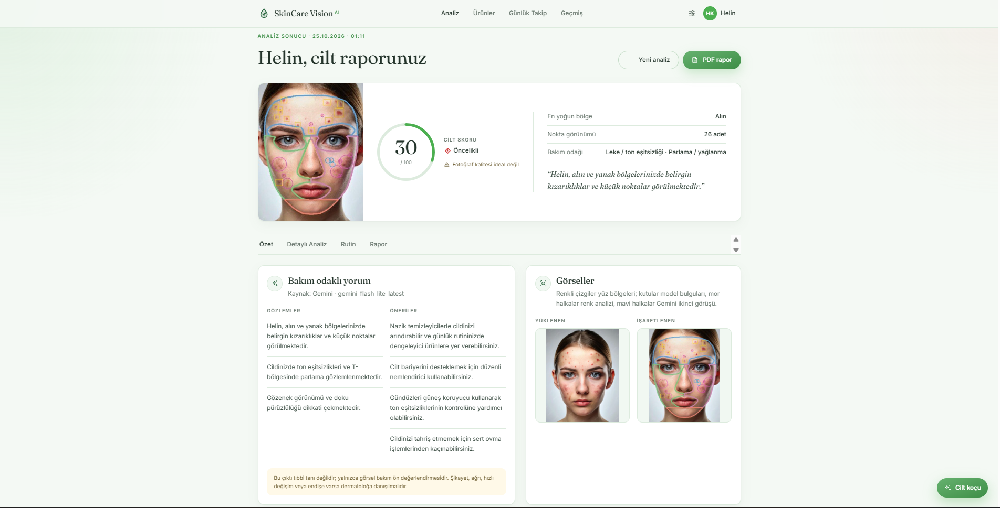
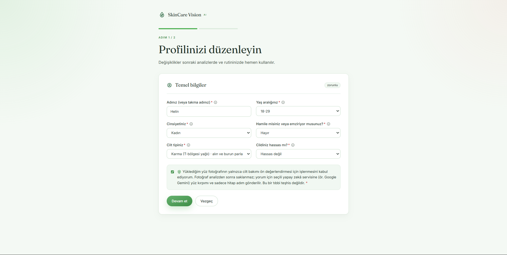
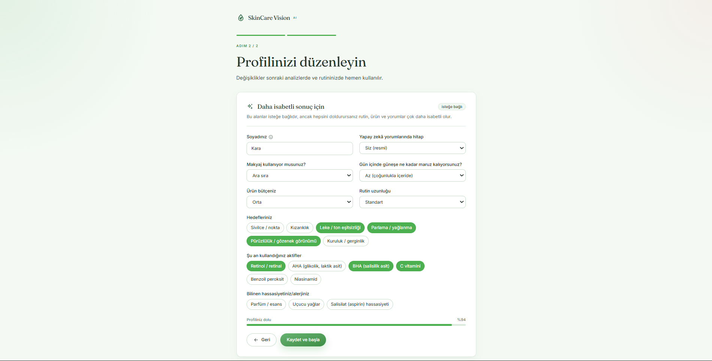
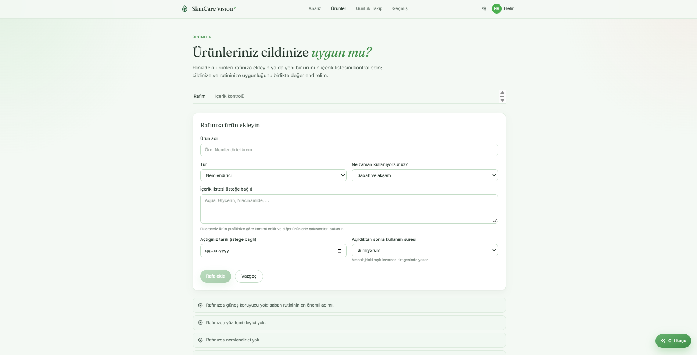
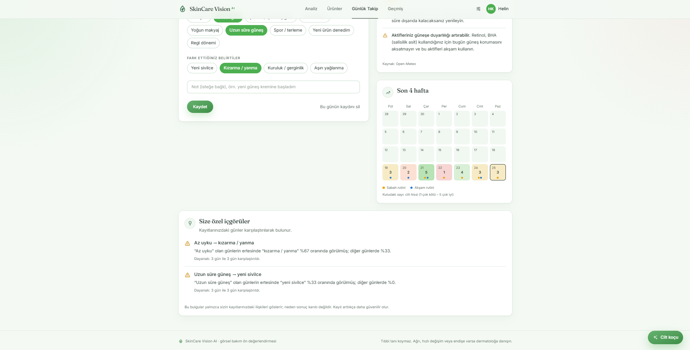
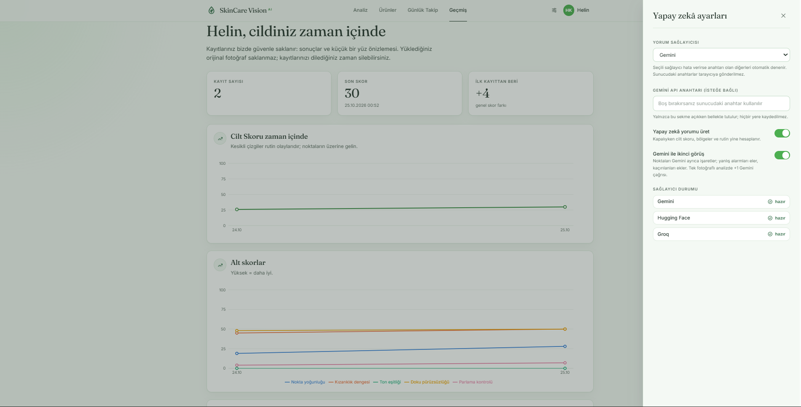
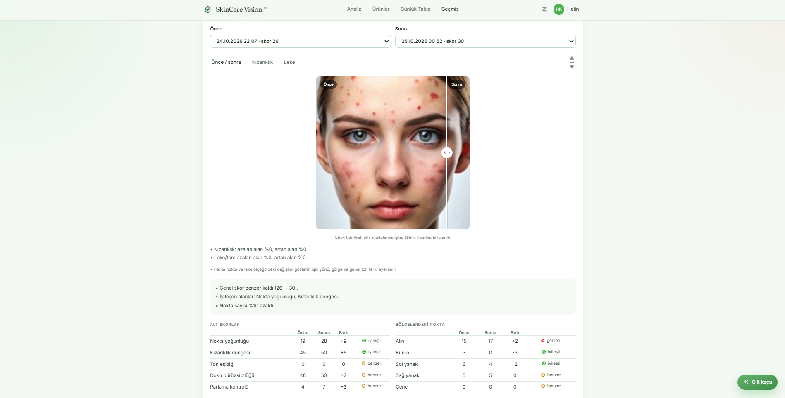
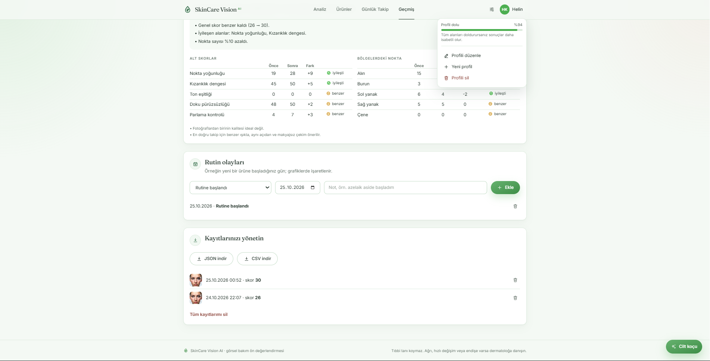

# SkinCare Vision AI

  <strong>Privacy-conscious, care-oriented facial skin appearance analysis.</strong>

  Analyze up to three facial views, build a personalized skincare routine, review products, and track visible changes over time.

  
  
  
  
  

> [!IMPORTANT]
> SkinCare Vision AI is not a medical device. It provides cosmetic, care-oriented visual estimates only. It does not diagnose disease, recommend prescription treatment, or replace a dermatologist.

  

## Table of contents

- [Overview](#overview)
- [Features](#features)
- [Screenshots](#screenshots)
- [Architecture](#architecture)
- [Technology stack](#technology-stack)
- [Quick start](#quick-start)
- [Docker](#docker)
- [Configuration](#configuration)
- [Security and privacy](#security-and-privacy)
- [Production deployment](#production-deployment)
- [Analysis methodology](#analysis-methodology)
- [API overview](#api-overview)
- [Testing and quality](#testing-and-quality)
- [Project structure](#project-structure)
- [Model limitations](#model-limitations)
- [Product catalog](#product-catalog)
- [License](#license)

## Overview

SkinCare Vision AI is a full-stack web application for non-medical facial skin appearance analysis. It combines deterministic image processing, MediaPipe face landmarks, a custom single-class YOLO detector, optional vision-language-model feedback, explainable routine generation, and local progress tracking.

The core analysis works without a cloud AI key. Gemini, Groq, and Hugging Face integrations are optional enhancements and use a controlled fallback chain.

## Features

### Skin appearance analysis

- Analyze one to three images: front, left, and right views
- Live camera guidance for distance, position, head angle, lighting, and sharpness
- MediaPipe 478-point face landmarks with an OpenCV Haar fallback
- Region-aware analysis for the forehead, nose, cheeks, and chin
- Eye, eyebrow, and lip exclusion masks
- Custom <code>acne_like_spot</code> YOLO detector with color-based candidates
- Optional Gemini-assisted second opinion for a single image
- Sclera-assisted white balance and a normalized 0–100 Skin Score
- Separate scores for spot density, redness balance, tone evenness, texture, and shine

### Personalized routines and products

- Explainable morning and evening routines based on profile data and measurements
- Safety checks for age, sensitivity, allergies, pregnancy, and breastfeeding
- Weekly scheduling that separates potentially conflicting active ingredients
- INCI review from pasted text or a photographed product label
- Product shelf with missing-step, duplicate-active, and PAO reminders
- Editable starter product catalog with source and verification metadata

### Tracking and reports

- Skin Score history and trend charts
- Aligned before-and-after comparison
- Redness and dark-mark change maps
- Daily routine adherence, triggers, symptoms, and personal insights
- PDF, JSON, and CSV exports
- Profile-level history deletion, including stored thumbnails

### Supporting tools

- UV, temperature, and humidity context powered by Open-Meteo
- A skincare coach that uses profile, routine, shelf, and journal context
- Provider fallback, circuit breaking, retries, and response caching

## Screenshots

### Profile setup

The first step collects required details and explicit photo-processing consent. The second step captures care goals and optional personalization data.

<table>
  <tr>
    <td width="50%"></td>
    <td width="50%"></td>
  </tr>
</table>

### Products and skincare coach

<table>
  <tr>
    <td width="50%"></td>
    <td width="50%"></td>
  </tr>
</table>

### Daily tracking

<table>
  <tr>
    <td width="50%"></td>
    <td width="50%"></td>
  </tr>
</table>

### History and comparison

<table>
  <tr>
    <td width="33%"></td>
    <td width="33%"></td>
    <td width="33%"></td>
  </tr>
</table>

## Architecture

~~~text
React 19 + Vite
        |
        | /api (JSON and multipart)
        v
FastAPI -- authentication, validation, rate and request-size limits
    |-- analysis/         multi-view processing, regions, metrics, change maps
    |-- detection/        YOLO, MediaPipe, and Haar fallback
    |-- recommendation/   routines, actives, INCI, catalog, and product shelf
    |-- history/          SQLite history, journal, comparisons, and insights
    |-- report/           PDF, text, JSON, and CSV output
    |-- vlm_engine.py     provider-specific HTTP clients
    `-- vlm_router.py     fallback, circuit breaker, retries, and cache
~~~

HTTP concerns remain in <code>src/api/server.py</code>. Analysis and business rules live in domain modules, while <code>src/api/container.py</code> manages long-lived model and service instances. In production, FastAPI serves the compiled frontend from <code>frontend/dist</code> on the same origin.

An analysis request follows this flow:

1. Authenticate the request and apply rate and total-body-size limits.
2. Validate image type, integrity, compressed size, and decoded pixel count.
3. Normalize the image inside an isolated temporary directory and strip EXIF metadata.
4. Detect the face and regions, then calculate care-oriented visual metrics.
5. If enabled, request a limited-context VLM comment and optional second opinion.
6. Delete temporary files. Store only a small preview when the user explicitly chooses to save the result.

## Technology stack

| Layer | Technologies |
|---|---|
| Frontend | React 19, TypeScript, Vite, Tailwind CSS v4, TanStack Query, Recharts |
| API | FastAPI, Pydantic, Uvicorn |
| Computer vision | Ultralytics YOLO, MediaPipe, OpenCV, Pillow, NumPy |
| Optional AI | Gemini, Groq, Hugging Face |
| Persistence | SQLite |
| Reports | ReportLab, JSON, CSV |
| Quality | Pytest, Ruff, Bandit, Vitest, Oxlint, Playwright, pip-audit, npm audit |
| Delivery | Docker, Docker Compose, GitHub Actions, Dependabot, GHCR |

## Quick start

### Requirements

- Python 3.10 or later; CI uses Python 3.12
- Node.js 22 or later
- Git
- At least one provider key only if optional AI commentary is required

### Windows and PowerShell

~~~powershell
git clone https://github.com/sudemkirmiz/skincare-vision-ai.git
cd skincare-vision-ai

python -m venv .venv

./.venv/Scripts/python.exe -m pip install --extra-index-url https://download.pytorch.org/whl/cpu -c constraints.txt -r requirements.txt
./.venv/Scripts/python.exe -m pip install --no-deps mediapipe==1.1.1

Copy-Item .env.example .env

cd frontend
npm ci
npm run build
cd ..

./.venv/Scripts/python.exe -m uvicorn api.server:app --app-dir src --host 127.0.0.1 --port 8000
~~~

Open <http://127.0.0.1:8000>. API documentation is available at <http://127.0.0.1:8000/docs> in development mode. Swagger, ReDoc, and the OpenAPI endpoint are disabled in public mode to reduce exposed surface area.

<code>constraints.txt</code> pins the direct dependency versions validated by CI and Docker. MediaPipe is installed with <code>--no-deps</code>, while its required runtime packages are declared explicitly in <code>requirements.txt</code>. This prevents <code>opencv-contrib-python</code> from replacing the OpenCV build used by YOLO.

### macOS and Linux

~~~bash
git clone https://github.com/sudemkirmiz/skincare-vision-ai.git
cd skincare-vision-ai

python3 -m venv .venv
./.venv/bin/python -m pip install --extra-index-url https://download.pytorch.org/whl/cpu -c constraints.txt -r requirements.txt
./.venv/bin/python -m pip install --no-deps mediapipe==1.1.1

cp .env.example .env

cd frontend
npm ci
npm run build
cd ..

./.venv/bin/python -m uvicorn api.server:app --app-dir src --host 127.0.0.1 --port 8000
~~~

### Development mode

Run the API and frontend in separate terminals:

~~~powershell
# Terminal 1
./.venv/Scripts/python.exe -m uvicorn api.server:app --app-dir src --port 8000 --reload
~~~

~~~powershell
# Terminal 2
cd frontend
npm run dev
~~~

Vite runs at <http://localhost:5173> and proxies <code>/api</code> requests to port 8000.

## Docker

### Local deployment

~~~powershell
Copy-Item .env.example .env
docker compose up --build -d
docker compose ps
~~~

The application is exposed only on <http://127.0.0.1:8000>.

~~~powershell
docker compose logs -f app
docker compose down
~~~

The named <code>skincare-vision-ai-state</code> volume keeps SQLite data after the container stops. To intentionally remove that data, first confirm that you are in the correct Compose project and then run:

~~~powershell
docker compose down --volumes
~~~

### Production Compose overlay

~~~powershell
Copy-Item .env.production.example .env.production
# Fill in the token, host name, origins, and provider keys.

$env:ENV_FILE = ".env.production"
docker compose --env-file .env.production `
  -f compose.yaml `
  -f compose.production.yaml `
  up --build -d
~~~

The production overlay forces <code>PUBLIC_DEPLOYMENT=true</code> and <code>ALLOW_USER_API_KEYS=false</code>. Compose fails closed when the access token, allowed hosts, or CORS origins are empty.

Container hardening includes:

- Multi-stage Node/Python build
- Fixed non-root user <code>10001:10001</code>
- Read-only root filesystem with writable <code>/tmp</code> and <code>/app/state</code>
- All Linux capabilities dropped
- <code>no-new-privileges</code> enabled
- Persistent data isolated from the product catalog
- PID and log-size limits
- Clean signal handling through <code>tini</code>
- Readiness-aware <code>/api/health</code> health check
- One worker to keep in-memory rate limits, caches, and circuit breakers consistent

Tagged <code>v*</code> releases and manually dispatched Container workflows publish an image to GHCR with SBOM and provenance attestations. Normal pushes and pull requests build the image without publishing it.

## Configuration

Copy <code>.env.example</code> to <code>.env</code>. The resulting file is ignored by Git. Never commit real provider keys or access tokens.

| Variable | Default | Purpose |
|---|---:|---|
| <code>GEMINI_API_KEY</code>, <code>GROQ_API_KEY</code>, <code>HF_TOKEN</code> | empty | Optional provider credentials |
| <code>VLM_PROVIDER</code> | <code>Gemini</code> | Default provider in the interface |
| <code>GEMINI_MODEL</code> | <code>gemini-3.5-flash</code> | Primary Gemini model |
| <code>GEMINI_FALLBACK_MODELS</code> | see example | Models attempted after quota or server errors |
| <code>GROQ_MODEL</code>, <code>HF_VLM_MODEL</code>, <code>HF_PROVIDER</code> | see example | Alternative provider configuration |
| <code>VLM_FALLBACK</code> | <code>true</code> | Use another configured provider on failure |
| <code>VLM_FALLBACK_ORDER</code> | see example | Provider fallback order |
| <code>VLM_SECOND_OPINION</code> | <code>true</code> | Optional Gemini spot review for one image |
| <code>VLM_TIMEOUT_SECONDS</code> | <code>90</code> | Provider request timeout |
| <code>VLM_MAX_RETRIES</code> | <code>2</code> | Retries for transient provider failures |
| <code>VLM_TRUST_ENV_PROXY</code> | <code>false</code> | Permit system proxy environment variables |
| <code>YOLO_MODEL_PATH</code> | <code>models/acne_like_spot.pt</code> | YOLO weight file |
| <code>YOLO_CONFIDENCE</code> | <code>0.10</code> | Detection confidence threshold |
| <code>YOLO_IMAGE_SIZE</code> | <code>640</code> | Detector input size |
| <code>FACE_LANDMARKER_PATH</code> | <code>models/face_landmarker.task</code> | MediaPipe model bundle |
| <code>HISTORY_ENABLED</code> | <code>true</code> | Enable profiles, history, journal, and shelf storage |
| <code>HISTORY_DB_PATH</code> | <code>data/history.db</code> | SQLite database location |
| <code>PRODUCT_CATALOG_PATH</code> | <code>data/products.json</code> | Editable product catalog |
| <code>MAX_UPLOAD_MB</code> | <code>10</code> | Compressed size limit per image |
| <code>MAX_IMAGE_PIXELS</code> | <code>40000000</code> | Decoded image pixel limit |
| <code>MAX_REQUEST_BODY_MB</code> | <code>32</code> | Total JSON or multipart request limit |
| <code>ANALYSIS_RATE_LIMIT</code> | <code>12</code> | Analyses per IP per hour |
| <code>LABEL_RATE_LIMIT</code> | <code>30</code> | Label-reader and coach requests per hour |
| <code>CAPTURE_RATE_LIMIT</code> | <code>600</code> | Camera quality checks per hour |
| <code>ALLOW_USER_API_KEYS</code> | <code>true</code> | Allow session-scoped provider keys |
| <code>PUBLIC_DEPLOYMENT</code> | <code>false</code> | Enforce production security requirements |
| <code>APP_ACCESS_TOKEN</code> | empty | Single-tenant application access token |
| <code>CORS_ORIGINS</code> | <code>http://localhost:5173</code> | Allowed browser origins |
| <code>ALLOWED_HOSTS</code> | local hosts | Accepted HTTP Host values |
| <code>LOG_LEVEL</code> | <code>INFO</code> | Application log level |

## Security and privacy

The application implements the following controls:

- Public mode requires an access token with at least 32 characters.
- Tokens are compared in constant time and kept only in <code>sessionStorage</code>.
- Public mode rejects browser-supplied provider keys.
- CORS origins, methods, and headers use explicit allowlists.
- Host headers are validated; wildcards are rejected in public mode.
- Request-body limits are enforced before multipart parsing for both fixed-length and chunked requests.
- Images are validated for size, format, integrity, and decoded pixel count.
- Camera preview frames are additionally limited to 2 million pixels and 1.5 MB.
- Analysis, label-reader, coach, and camera endpoints have IP-based rate limits.
- CSP, HSTS, X-Content-Type-Options, X-Frame-Options, Referrer-Policy, and Permissions-Policy headers are applied.
- Public health responses reveal readiness only; protected <code>/api/status</code> contains operational details.
- Profile, analysis, and history responses use <code>Cache-Control: no-store</code>.
- CSV exports neutralize spreadsheet formula injection.
- Circuit-breaker state is scoped by provider and credential.
- Unexpected server errors do not expose internal details to clients.

Photos are processed inside isolated temporary directories and removed after analysis. If the user explicitly saves a result, the application may retain a face preview no wider than 320 pixels in SQLite. Camera quality-check frames are never stored.

Server-side provider keys are never returned to the browser. VLM requests receive a face crop, limited analysis context, preferred name, and form of address. They do not receive surname, gender, or pregnancy and breastfeeding answers. External provider use still constitutes third-party processing; review the selected provider's privacy and retention terms before production deployment.

See [SECURITY.md](SECURITY.md) for vulnerability reporting and supported-version guidance.

## Production deployment

This repository defaults to local, single-tenant operation. Before exposing it to a network:

1. Generate a random access token:

   ~~~powershell
   python -c "import secrets; print(secrets.token_urlsafe(32))"
   ~~~

2. Configure production values:

   ~~~dotenv
   PUBLIC_DEPLOYMENT=true
   ALLOW_USER_API_KEYS=false
   APP_ACCESS_TOKEN=replace-with-generated-secret
   ALLOWED_HOSTS=skin.example.com
   CORS_ORIGINS=https://skin.example.com
   ~~~

3. Place the application behind a trusted TLS/HTTPS reverse proxy.
4. Enforce connection, body-size, and centralized rate limits at the proxy.
5. Never publish <code>.env</code>, <code>data/history.db</code>, user images, or backups.
6. Define encrypted, access-controlled backup and retention policies.
7. Rotate provider keys and assign the minimum practical quota and permissions.
8. Keep CI security checks and Dependabot alerts enabled.

<code>APP_ACCESS_TOKEN</code> is a single-tenant access barrier, not a user-account system. A multi-user service requires an identity provider such as OIDC, per-user authorization, centralized rate limiting, and audit logging.

## Analysis methodology

Five subscores are calculated from the normalized face crop using classical image processing and, where applicable, detector outputs:

| Subscore | Measurement approach | Weight |
|---|---|---:|
| Spot density | YOLO, color candidates, optional second opinion | 35% |
| Redness balance | CIELAB a* distribution and regional differences | 25% |
| Tone evenness | Brightness variation after illumination normalization | 15% |
| Texture smoothness | Fine-scale luminance energy | 15% |
| Shine control | Specular-highlight area | 10% |

Calibration thresholds live in <code>src/analysis/skin_metrics.py</code>. Lighting, camera characteristics, pose, and image quality affect every result; scores must not be interpreted as clinical measurements.

## API overview

The FastAPI application exposes grouped endpoints for:

| Area | Representative endpoints |
|---|---|
| Health and configuration | <code>GET /api/health</code>, <code>GET /api/status</code>, <code>GET /api/options</code> |
| Profiles | <code>GET/POST /api/profiles</code>, <code>GET/PUT/DELETE /api/profiles/{id}</code> |
| Analysis | <code>POST /api/analyses</code>, routine, product, report, and save endpoints |
| History and comparison | profile history, thumbnails, comparisons, maps, and exports |
| Journal and events | daily journal CRUD and profile events |
| Product shelf | profile-scoped shelf CRUD |
| Product review | ingredient check and photographed-label reading |
| Coach and weather | suggestions, chat, location search, and weather context |
| Camera guidance | <code>POST /api/capture/check</code> |

Interactive OpenAPI documentation is available at <code>/docs</code> only outside public mode.

## Testing and quality

### Backend

~~~powershell
pip install -c constraints.txt -r requirements-dev.txt
ruff check .
python -m bandit -r src -q
pytest
~~~

### Frontend

~~~powershell
cd frontend
npm ci
npm run lint
npm run typecheck
npm test
npm run build
npx playwright install chromium
npm run test:e2e
~~~

The test suite blocks real network access and mocks provider calls. Playwright exercises the primary flow, access-token entry, and recoverable profile errors in Chromium.

GitHub Actions runs the following checks on pushes and pull requests:

- Python linting, Bandit security analysis, and Pytest
- Runtime dependency import smoke test
- Python dependency audit with pip-audit
- Frontend lint, type checking, unit tests, and production build
- npm audit and Playwright end-to-end tests
- Docker image build with BuildKit

Dependabot monitors Python, npm, and GitHub Actions dependencies.

## Project structure

~~~text
skincare-vision-ai/
|-- .github/
|   |-- workflows/              CI and GHCR image publishing
|   `-- dependabot.yml          dependency update automation
|-- assets/                     PDF font assets
|-- data/
|   |-- products.json           verified starter catalog
|   `-- products.example.json   catalog schema example
|-- docs/                       model training and dataset governance
|-- frontend/
|   |-- e2e/                    Playwright scenarios
|   `-- src/                    React application
|-- licenses/                   third-party license texts
|-- models/                     YOLO and MediaPipe model files
|-- scripts/                    evaluation utilities
|-- src/
|   |-- analysis/               analysis pipeline and metrics
|   |-- api/                    FastAPI, schemas, security, service container
|   |-- detection/              face and visual-feature detection
|   |-- history/                SQLite persistence and insights
|   |-- recommendation/         routines, INCI rules, and catalog
|   |-- report/                 report generation
|   |-- safety/                 medical-claim filtering
|   `-- users/                  profiles and onboarding rules
|-- tests/                      offline backend test suite
|-- compose.yaml                hardened local container setup
|-- compose.production.yaml     production requirements overlay
|-- Dockerfile
|-- LICENSE
|-- SECURITY.md
|-- THIRD_PARTY_NOTICES.md
`-- README.md
~~~

Local inputs, outputs, build artifacts, SQLite databases, and environment files are excluded through <code>.gitignore</code>. Model source, license, and SHA-256 details are recorded in <code>THIRD_PARTY_NOTICES.md</code>.

## Model limitations

The bundled YOLO detector has one class: <code>acne_like_spot</code>. Its current mAP50 is approximately 0.37, so it is not a definitive or clinical detector. Color analysis and the optional second opinion are complementary signals, not confirmation of a condition.

The most valuable next model iteration is retraining on a larger, licensed dataset that represents different skin tones, lighting conditions, cameras, and hard negatives such as freckles, moles, pores, and shadows.

> [!WARNING]
> Before redistributing <code>models/acne_like_spot.pt</code>, document the source and redistribution permission for every training dataset. Model licensing and dataset rights are separate obligations.

## Product catalog

<code>data/products.json</code> is a six-item starter catalog containing product names, official pages, INCI data where available, and verification dates. Recheck entries against official manufacturer sources before release because formulas and URLs can change.

## License

This project is licensed under the **GNU Affero General Public License v3.0 or later (AGPL-3.0-or-later)** because it depends on Ultralytics YOLO and includes a YOLO-trained model.

- Read [LICENSE](LICENSE) for the complete project license.
- Read [THIRD_PARTY_NOTICES.md](THIRD_PARTY_NOTICES.md) for model, font, and trademark notices.
- Review the [Ultralytics licensing options](https://www.ultralytics.com/license) before closed-source or commercial deployment.

If you modify this application and make it available over a network, the AGPL requires eligible users to receive access to the corresponding source code. Closed-source use may require an Ultralytics Enterprise license. This summary is not legal advice.

Copyright © 2026 Sudem Kırmız.
