

  <picture>
    <source media="(prefers-color-scheme: dark)" srcset="frontend/public/brand/logo-tile-dark.svg">
    
  </picture>

<h1 align="center">SkinCare Vision AI</h1>

  <strong>Computer vision skincare assistant that turns one selfie into a measured Skin Score, an explainable routine and a weekly plan built from the products you already own.</strong>

<b>English</b> · <a href="README.tr.md">Türkçe</a>

  
  
  
  
  
  
  
  

  
  &nbsp;
  
  &nbsp;
  

  <a href="https://sudemkirmiz.github.io/skincare-vision-ai/">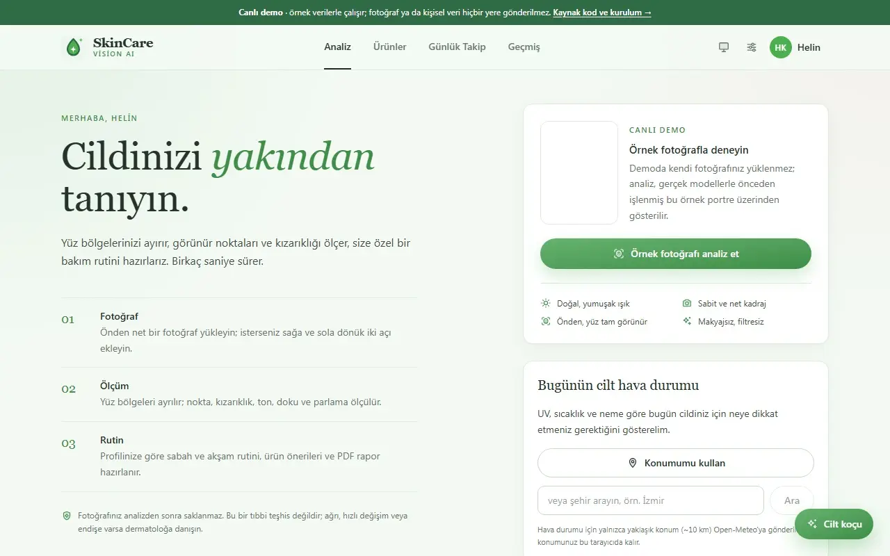</a>

> [!IMPORTANT]
> SkinCare Vision AI is not a medical device. It gives cosmetic, care-oriented visual estimates only. It does not diagnose disease, recommend prescription treatment, or replace a dermatologist. The interface is in Turkish.

## Highlights

<table>
  <tr>
    <td width="33%" valign="top"><b>Measures, then explains</b> MediaPipe's 478 face landmarks split the face into regions; a custom YOLO detector, CIELAB colour analysis and sclera-based white balance produce five sub-scores and a 0–100 Skin Score. Every recommended active cites the score that triggered it.</td>
    <td width="33%" valign="top"><b>Works without an AI key</b> Analysis, scores, routine, shelf planner and a personal, rule-based care comment run fully offline. Gemini, OpenAI, Groq or Hugging Face only add a richer comment, with automatic fallback, circuit breaking and caching.</td>
    <td width="33%" valign="top"><b>Plans with what you own</b> The shelf planner orders your products thin-to-thick and builds a 7-night skin-cycling calendar in which conflicting actives (retinol, AHA, BHA) never share a night.</td>
  </tr>
  <tr>
    <td valign="top"><b>Built for daily use</b> Installable PWA, guided camera capture, one-tap routine check-in, streaks and badges, on-device reminders, personal trigger insights, light and dark themes.</td>
    <td valign="top"><b>Private by design</b> Photos never touch the disk. Each browser sees only its own profiles on a shared link. Strict CSP, constant-time token checks, CSRF-safe cookies, request limits before parsing, a hardened read-only container.</td>
    <td valign="top"><b>Tested like a product</b> 247 backend tests (including a route-by-route security suite), 22 frontend unit tests and Playwright end-to-end tests, all offline. CI runs Ruff, Bandit, CodeQL, pip-audit, npm audit, type checks and a Docker build on every push.</td>
  </tr>
</table>

## Contents

[Try it](#try-it) · [Features](#features) · [AI providers](#ai-providers-and-the-no-key-mode) · [Phone and sharing](#use-it-on-your-phone-and-share-it-with-friends) · [Architecture](#architecture) · [Quick start](#quick-start) · [Security](#security-and-privacy) · [Testing](#testing-and-quality) · [Documentation](#documentation) · [License](#license)

## Try it

| | What you get | What you need |
| --- | --- | --- |
| **[Live demo](https://sudemkirmiz.github.io/skincare-vision-ai/)** | The whole interface on desktop or phone, with a real analysis of an AI-generated sample portrait and a few weeks of sample history | Nothing; runs in the browser, nothing is uploaded |
| **[Run locally](#quick-start)** | Analysis of your own photos, camera guidance, history, shelf, coach | Python 3.10+, Node.js 22+ |
| **[Share from your computer](#use-it-on-your-phone-and-share-it-with-friends)** | An HTTPS invite link for friends' phones; each phone keeps its own private profiles | The local install plus `cloudflared` |

## Features

### Analysis

- One to three photos (front, left, right) merged region by region, or **guided camera capture** that checks distance, framing, head angle, light and sharpness live and shoots automatically
- MediaPipe face landmarks with an OpenCV Haar fallback; forehead, nose, cheeks and chin measured separately, with eyes, brows and lips masked out
- Custom single-class <code>acne_like_spot</code> YOLO detector plus colour candidates, and an optional Gemini second opinion that removes false alarms
- Five sub-scores (spot density, redness balance, tone evenness, texture, shine) and a weighted Skin Score, with photo-quality checks and profile-versus-photo hints

<table>
  <tr>
    <td width="33%">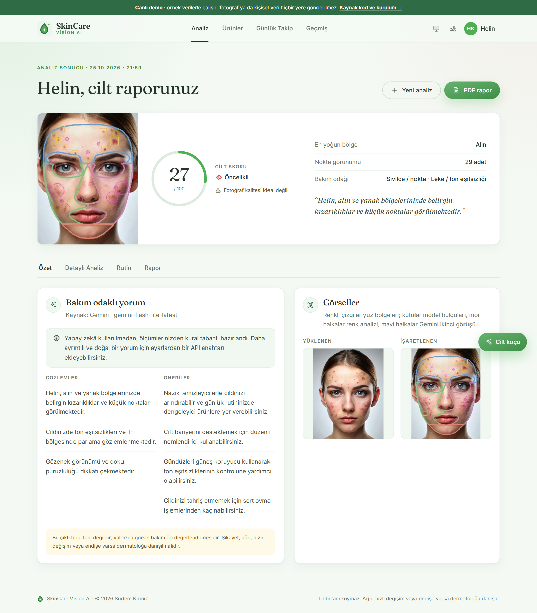</td>
    <td width="33%">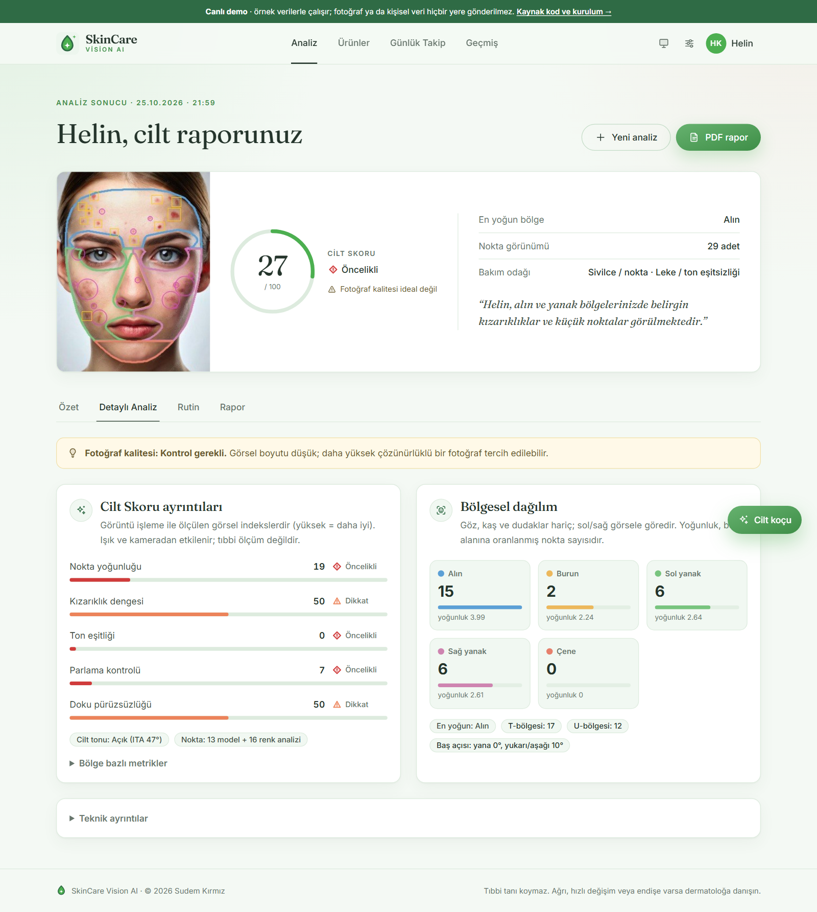</td>
    <td width="33%">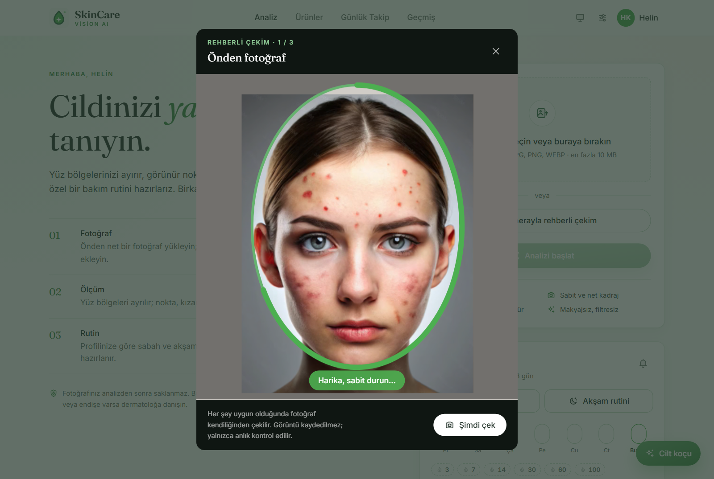</td>
  </tr>
</table>

### Routine, products, and planning

- Explainable morning and evening routine from the measurements and the profile, with safety rules for age, sensitivity, allergies, pregnancy and breastfeeding
- INCI ingredient checker from pasted text or a photographed label: verdict, actives found, cautions and positives
- Product shelf with conflict, duplicate-active, missing-step and period-after-opening (PAO) checks
- **Shelf planner:** application order (sunscreen always last) and a 7-night skin-cycling calendar from the user's own products; conflicting actives always on separate nights, fewer active nights for sensitive skin, expired products left out

<table>
  <tr>
    <td width="33%">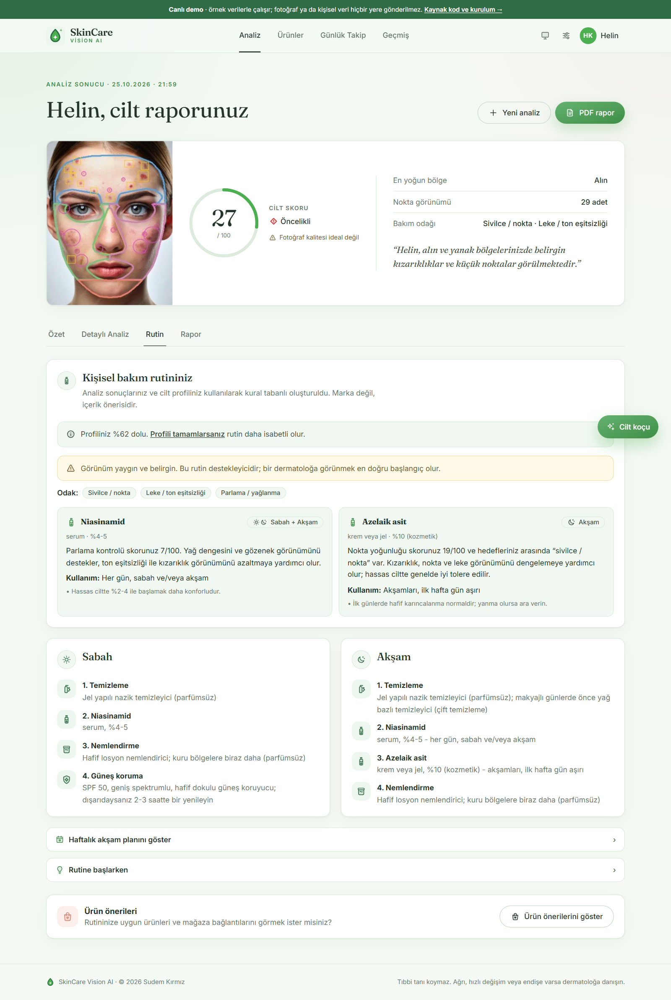</td>
    <td width="33%">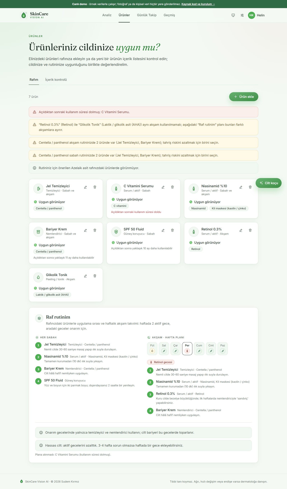</td>
    <td width="33%">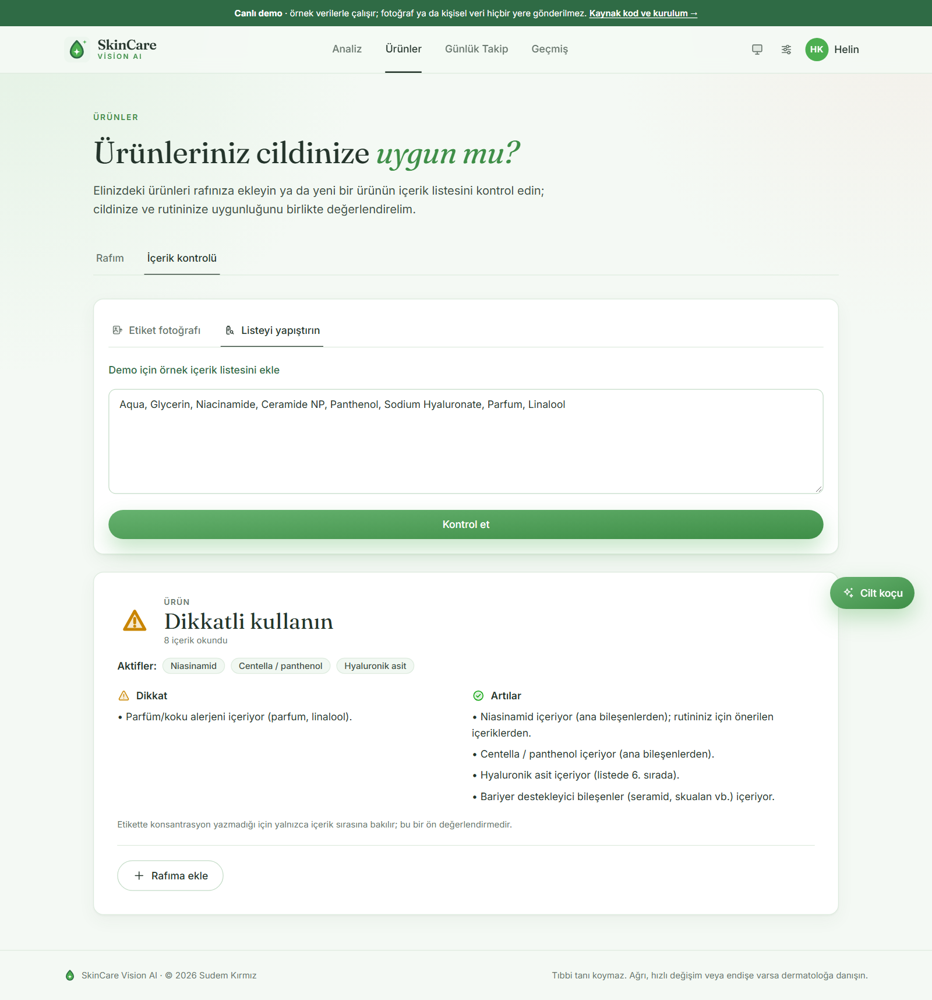</td>
  </tr>
</table>

### Tracking, history, and reports

- One-tap morning and evening check-in, routine streaks with 3 to 100-day badges, and on-device reminders that stay quiet once the routine is ticked
- Daily journal (skin feel, triggers, symptoms) and personal insights such as "after short-sleep days your skin felt 2.3 points worse", always worded as associations
- Score trends with routine events, an aligned before-and-after slider, and redness and dark-mark change maps
- Multi-page PDF report, JSON and CSV export, and a shareable skin-journey card drawn in the browser from scores only, never from photos

<table>
  <tr>
    <td width="33%">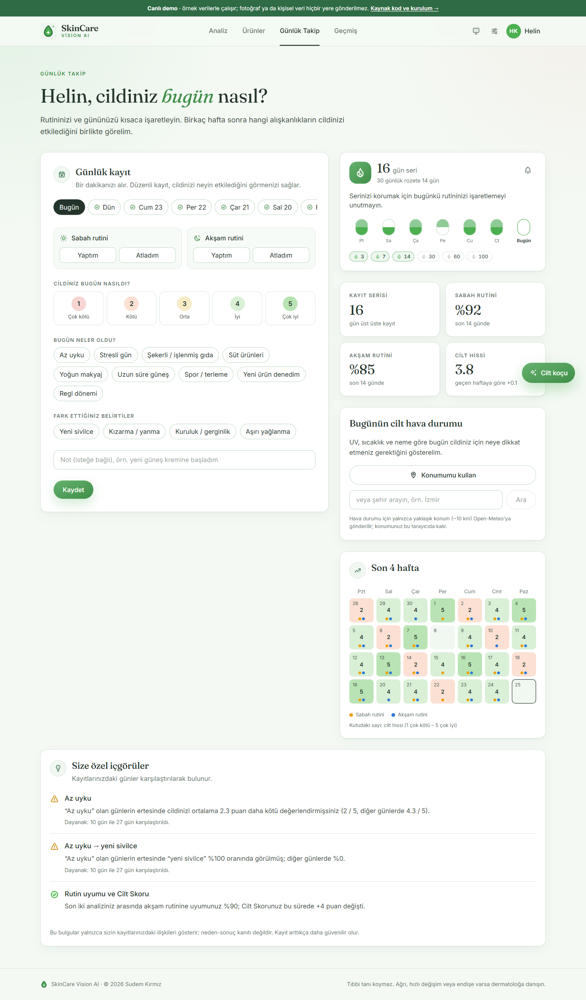</td>
    <td width="33%">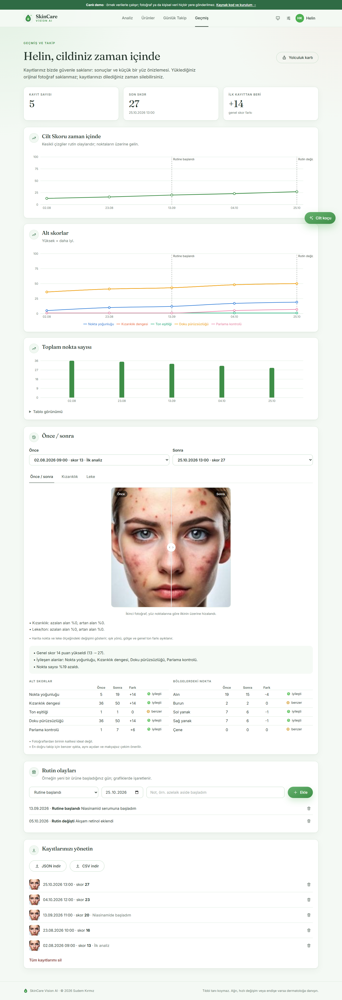</td>
    <td width="33%">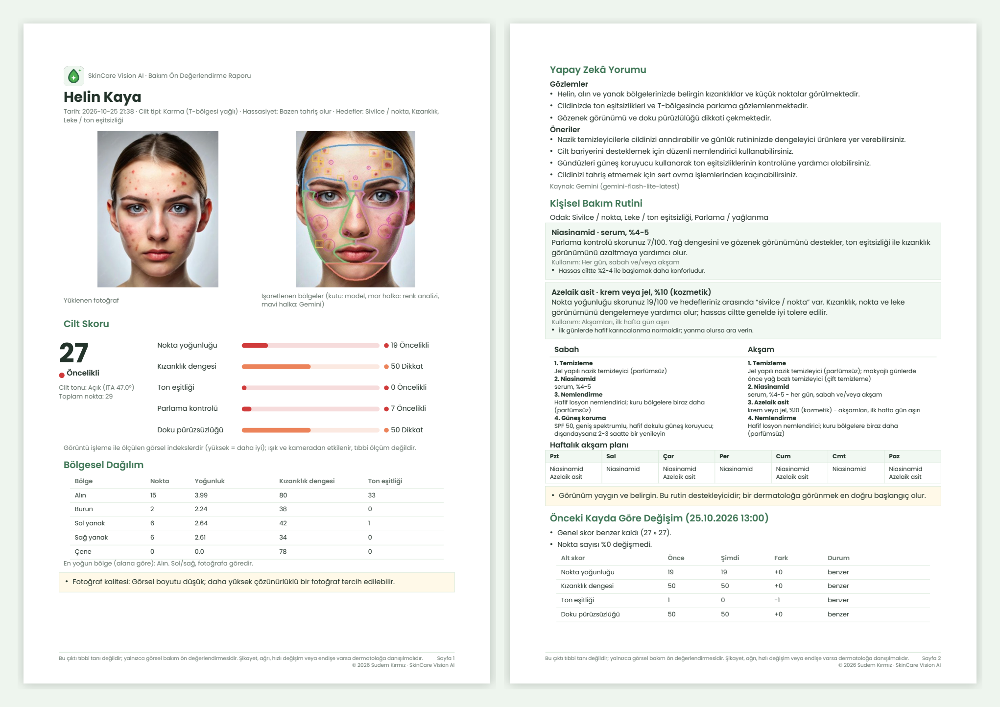</td>
  </tr>
</table>

### Coach, profile, and app experience

- A skincare coach that answers with the user's profile, routine, shelf, journal and today's UV and humidity in context
- Two-step onboarding with explicit photo-processing consent, and multiple profiles
- Installable PWA with an offline shell, light, dark and system themes, and a layout tuned for phones

<table>
  <tr>
    <td width="30%">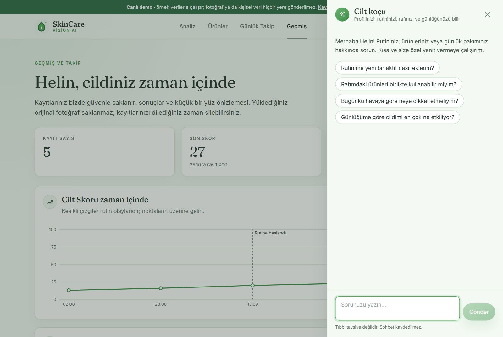</td>
    <td width="22%">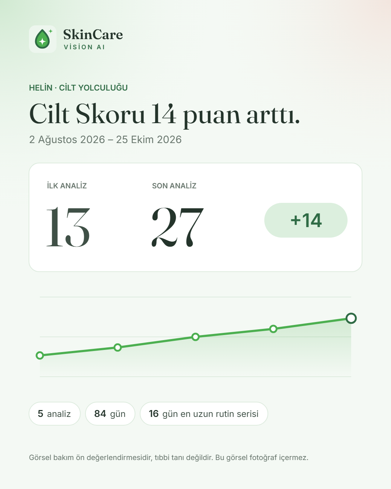</td>
    <td width="24%">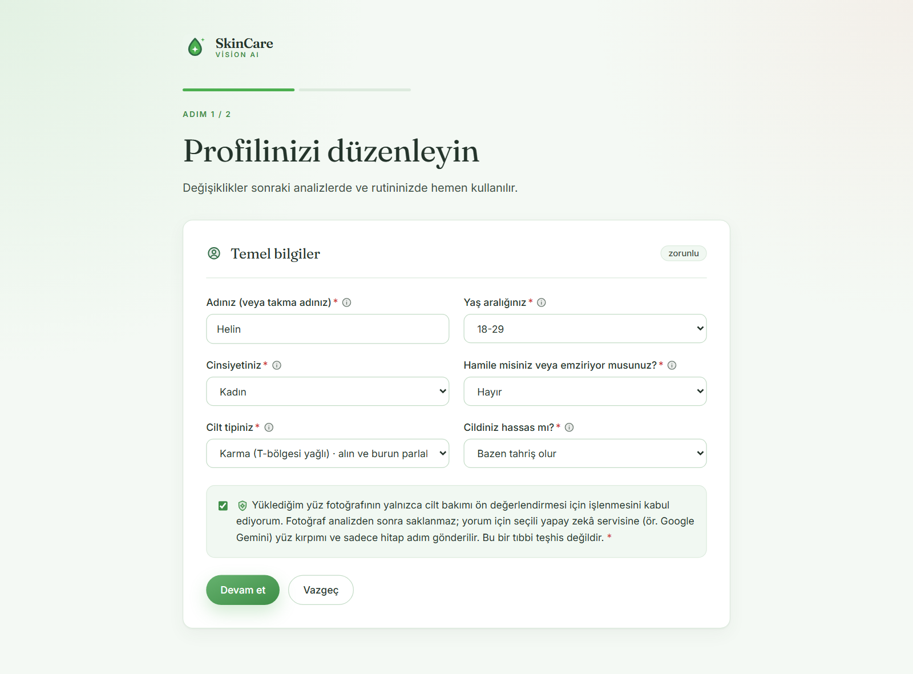</td>
    <td width="12%">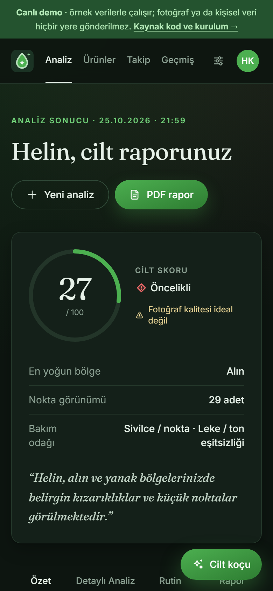</td>
    <td width="12%">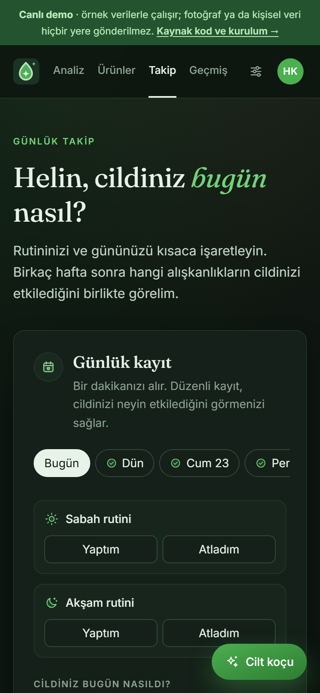</td>
  </tr>
</table>

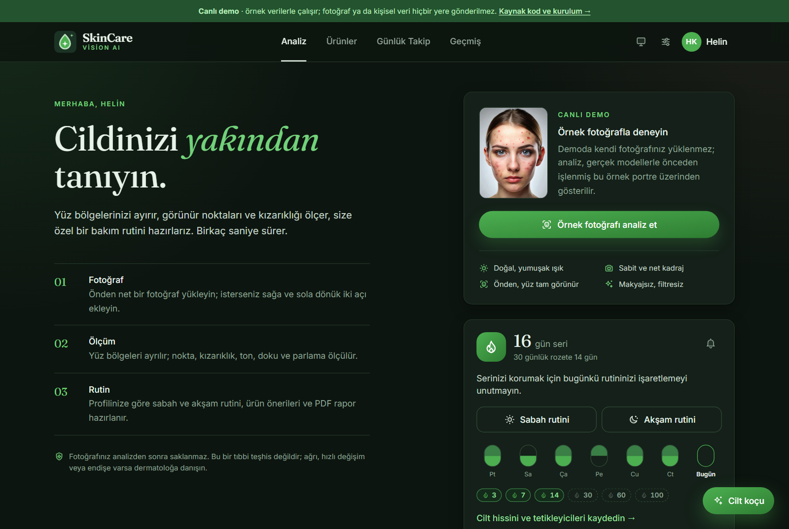

## AI providers and the no-key mode

The core pipeline never needs a cloud model. An AI provider only writes the free-text care comment, reads product labels from photos and powers the coach.

| Provider | Default model | Cost | Notes |
| --- | --- | --- | --- |
| **No key** | local rule engine | free | Personal comment from the measurements: severity-graded wording, the worst region and T/U-zone pattern, combined findings, profile goals and progress since the last saved analysis; every sentence maps to a number on screen |
| **Gemini** | <code>gemini-3.8-flash</code>, then three fallback models | free tier available | Recommended start; also powers the spot second opinion. [Get a key](https://aistudio.google.com/apikey) |
| **OpenAI** | <code>gpt-6-luna</code> via the Responses API | paid, lowest-priced vision model | [Get a key](https://platform.openai.com/api-keys) |
| **Groq** | <code>meta-llama/llama-4-scout-17b-16e-instruct</code> | free tier available | OpenAI-compatible endpoint |
| **Hugging Face** | <code>google/gemma-3-4b-it</code> | free credits | Any vision model on Inference Providers |

Server keys live in <code>.env</code> and never reach the browser. When <code>ALLOW_USER_API_KEYS=true</code>, users can type their own key; it stays in tab memory (or on that device, if they choose "remember on this device") and is never stored on the server. If the chosen provider fails, the others that have a key are tried in turn; if all fail, the rule-based comment is shown with the reason. Every model name is a variable, so a retired model needs no code change ([configuration](docs/configuration.md)).

## Use it on your phone and share it with friends

**Just looking around:** send the [live demo](https://sudemkirmiz.github.io/skincare-vision-ai/) link. It works on any phone, installs to the home screen and uploads nothing.

**Real analyses from your computer:** one command creates a free HTTPS invite link through a Cloudflare quick tunnel; phone cameras need HTTPS.

~~~powershell
winget install Cloudflare.cloudflared        # macOS: brew install cloudflared
.\.venv\Scripts\python scripts\share.py
~~~

Opening the invite link saves the access token on that phone. **Each phone sees only its own profiles, history, journal and shelf**: the browser keeps a random device key and the server stores only its SHA-256 hash. Friends can use their own Gemini or OpenAI key, or no key at all. The link works while your computer is on. For always-on hosting and the production checklist, see [deployment](docs/deployment.md).

## Architecture

~~~mermaid
flowchart LR
    subgraph Browser["Browser / installed PWA"]
        UI["React 19 + TypeScript TanStack Query, Tailwind v4"]
        SW["Service worker app shell only"]
    end
    subgraph API["FastAPI (one origin)"]
        Guard["Guard: token, device scope, body and rate limits, CSP"]
        Pipeline["Analysis pipeline"]
        Plan["Routine, INCI, shelf planner, local comment"]
        Store[("SQLite profiles, history, journal, shelf")]
    end
    subgraph Vision["On-device models"]
        MP["MediaPipe 478 landmarks"]
        YOLO["YOLO acne_like_spot"]
        CV["OpenCV metrics CIELAB, white balance"]
    end
    subgraph Cloud["Optional AI (fallback chain)"]
        G["Gemini"]
        O["OpenAI"]
        Q["Groq"]
        H["Hugging Face"]
    end
    UI -->|"/api"| Guard --> Pipeline
    Pipeline --> MP & YOLO & CV
    Pipeline --> Plan --> Store
    Pipeline -.->|"face crop + limited context"| G & O & Q & H
~~~

Measurements come first and stay deterministic; a language model only phrases the comment. Photos are processed in a temporary directory and deleted, and providers receive only a face crop plus the preferred name and form of address. Module layout, request flow, design decisions, scoring weights and the API map are in [architecture](docs/architecture.md).

| Layer | Technologies |
|---|---|
| Frontend | React 19, TypeScript, Vite, Tailwind CSS v4, TanStack Query, Recharts, service worker |
| API | FastAPI, Pydantic, Uvicorn |
| Computer vision | Ultralytics YOLO, MediaPipe, OpenCV, Pillow, NumPy |
| Optional AI | Gemini, OpenAI (Responses API), Groq, Hugging Face Inference Providers |
| Data and reports | SQLite with versioned migrations, ReportLab, JSON, CSV, Canvas |
| Quality and delivery | Pytest, Ruff, Bandit, CodeQL, pip-audit, Vitest, Oxlint, Playwright, Docker, GitHub Actions, GitHub Pages |

## Quick start

Requirements: Python 3.10+ (CI uses 3.12), Node.js 22+ and Git. A provider key is optional.

~~~powershell
git clone https://github.com/sudemkirmiz/skincare-vision-ai.git
cd skincare-vision-ai

python -m venv .venv
./.venv/Scripts/python.exe -m pip install --extra-index-url https://download.pytorch.org/whl/cpu -c constraints.txt -r requirements.txt
./.venv/Scripts/python.exe -m pip install --no-deps mediapipe==1.1.1
Copy-Item .env.example .env

cd frontend; npm ci; npm run build; cd ..
./.venv/Scripts/python.exe -m uvicorn api.server:app --app-dir src --host 127.0.0.1 --port 8000
~~~

Open <http://127.0.0.1:8000>. On macOS and Linux use <code>python3</code>, <code>./.venv/bin/python</code> and <code>cp</code> instead. MediaPipe is installed with <code>--no-deps</code> so it cannot replace the OpenCV build that YOLO uses.

For development, run the API with <code>--reload</code> and the frontend with <code>cd frontend; npm run dev</code> (Vite on <http://localhost:5173>, proxying <code>/api</code> to port 8000). Docker: <code>docker compose up --build -d</code>; see [deployment](docs/deployment.md).

## Security and privacy

- Every <code>/api</code> route requires the access token in public mode; a test walks all routes so a new endpoint cannot ship unprotected. Wrong tokens pause the IP after 20 tries.
- Device-scoped profiles isolate people sharing one link; another device's data answers exactly like missing data.
- Cookies (needed for images and downloads) authenticate reads only; writes need headers, which cross-site requests cannot send.
- Strict CSP in every mode, HSTS, COOP and CORP, host and CORS allowlists, body limits before parsing, image and pixel-bomb validation.
- Photos never touch the disk; the service worker never caches <code>/api</code>; personal keys are never stored or logged.
- CI runs Bandit, CodeQL, pip-audit and npm audit; Dependabot watches dependencies.

Details and vulnerability reporting: [SECURITY.md](SECURITY.md).

## Testing and quality

~~~powershell
pytest; ruff check .; python -m bandit -r src -q                      # backend
cd frontend; npm run lint; npm run typecheck; npm test; npm run test:e2e   # frontend
~~~

The suites block real network access and mock every provider call. They cover the vision pipeline and metrics, routine and safety rules, the shelf planner, the local comment, provider clients and fallback, the API including public mode and device isolation, the security regression suite, the demo data layer, reminders and the main browser flows. GitHub Actions runs all of them, plus a Docker build and the Pages demo deployment, on every push.

## Documentation

| Document | Contents |
| --- | --- |
| [Architecture](docs/architecture.md) | Module layout, request flow, design decisions, scoring, API map |
| [Configuration](docs/configuration.md) | Every environment variable and its default |
| [Deployment and sharing](docs/deployment.md) | Invite links for friends, Docker, hosting, production checklist |
| [Live demo](docs/live-demo.md) | How the browser-only demo works and how to rebuild it and the README media |
| [Model training](docs/model-training.md) | Dataset requirements, provenance and the reproducible YOLO training workflow |
| [Security policy](SECURITY.md) | Built-in protections and how to report a vulnerability |

## Project structure

~~~text
skincare-vision-ai/
|-- .github/workflows/   CI, CodeQL, container image and the Pages demo
|-- assets/              PDF fonts and the report logo
|-- data/                starter product catalog and its schema
|-- docs/                architecture, configuration, deployment, demo, model training
|-- frontend/            React app (src/), demo data layer (src/demo/), brand files, e2e tests, media scripts
|-- licenses/            third-party license texts
|-- models/              YOLO and MediaPipe model files
|-- screenshots/         README media, generated from the demo
|-- scripts/             sharing, demo data, README animation and sample evaluation
|-- src/                 Python backend: api, analysis, detection, vlm, recommendation, history, ...
`-- tests/               offline backend test suite, including tests/test_security.py
~~~

## Model limitations

The bundled YOLO detector has one class, <code>acne_like_spot</code>, and a current mAP50 of about 0.37: a useful signal, not a definitive or clinical detector. Colour analysis and the optional second opinion are complementary signals, not confirmation of a condition. The most valuable next step is retraining on a larger, licensed dataset that covers different skin tones, lighting, cameras and hard negatives such as freckles, moles, pores and shadows ([model training](docs/model-training.md)).

## License

**Copyright © 2026 Sudem Kırmız.** Original author and copyright holder of the code, interface, documentation, name and logo.

| Part | Terms |
| --- | --- |
| Source code | [GNU AGPL-3.0-or-later](LICENSE): anyone who modifies or runs it for others, even only over a network, must keep the copyright notices and publish their full source under the same license |
| Name "SkinCare Vision AI" and the logo | **All rights reserved.** Not covered by the AGPL (section 7(e)); forks must use their own name and logo. See [TRADEMARKS.md](TRADEMARKS.md) |
| Third-party models, fonts, libraries and the sample portrait | Their own licenses and owners; see [THIRD_PARTY_NOTICES.md](THIRD_PARTY_NOTICES.md) |

The AGPL is required because the project depends on Ultralytics YOLO and ships a YOLO-trained model; review the [Ultralytics licensing options](https://www.ultralytics.com/license) before any closed-source or commercial use. Every source file carries an SPDX header with the copyright line, and the [NOTICE](NOTICE) file must travel with every copy. This summary is not legal advice.

   
  Designed and built by <b>Sudem Kırmız</b> · © 2026

